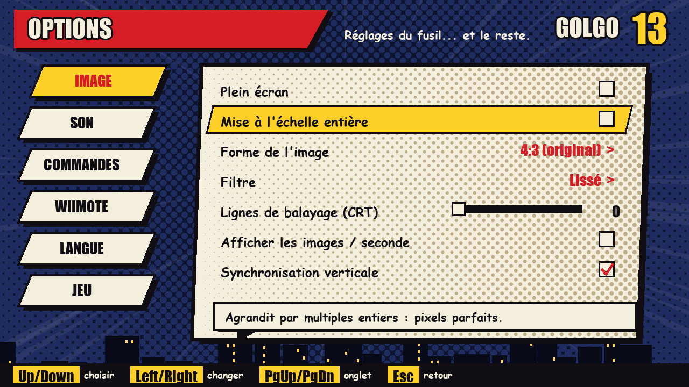

# Golgo 13 — port natif (arcade Namco System 12)

Port **natif** (C11 + SDL3) de *Golgo 13* (arcade, 1999) : le code du jeu est recompilé statiquement MIPS → C, sans interpréteur de CPU.
Les **ROM ne sont pas fournies** : il faut les tiennes (set MAME `golgo13`). Le C généré en dérive et n'est pas redistribué.

## Démarrage

1. Construire (voir plus bas), puis importer tes ROM une fois :
   ```
   golgo13.exe --import chemin\vers\golgo13.zip     (ou un dossier)
   ```
   Sans ROM, le jeu affiche un écran « fournis tes ROM » (glisser-déposer du zip sur la fenêtre, ou Entrée / clic).
2. Lancer : `golgo13.exe` — en français : `golgo13.exe --lang fr` (ou menu langue avec **F4**).

## Choix du jeu

Au lancement (fenêtre), un sélecteur liste **tous** les jeux connus, avec l'état des ROM (dossier ou zip trouvé dans le dossier de données ou dans `./roms`, sous la forme `roms/<id>/` ou `roms/<id>.zip`) :

| id | Jeu | État |
|---|---|---|
| `golgo13` | Golgo 13 (1999, System 12) | jouable |
| `g13knd` | Golgo 13 : Kiseki no Dandou (2000, System 12) | jouable, traduction française avancée |
| `g13jnr` | Golgo 13 : Juusei no Requiem (2001, System 10 + MP3) | jouable, avec son (effets SPU + musique MP3 ; le processeur de la carte MP3 est reproduit en haut niveau), traduction française en cours |

Haut/Bas, puis Entrée (ou clic) pour lancer ; le dernier choix est retenu. `--game <id>` saute le sélecteur (outils, tests ; par défaut `golgo13` en mode sans fenêtre).

## Le menu


Au lancement, un menu « planche de manga » liste les jeux : on choisit une carte (flèches, souris, manette ou pointeur de Wiimote), puis **JOUER**. **F1** ouvre les options, **Échap** met le jeu en pause (reprendre, options, changer de jeu, réinitialiser, quitter).

| Options | Langue |
|---|---|
|  |  |

- **Image** : plein écran (F11), échelle entière, 4:3 ou fenêtre, filtre net/lissé, lignes de balayage CRT, FPS, vsync.
- **Son** : volume, coupure. **Commandes** : 2 touches par action (capture de touche), réinitialisation. **Wiimote** : activer, lissage, zone morte, appairer, calibrer.
- **Langue** : Original ou une traduction trouvée dans `translations/`. **Jeu** : crédits toujours au maximum, la gâchette (ou le zoom) sert de Start (on joue à la souris seule : tir + zoom), enregistrement des sessions, viseur.
- Réglages enregistrés dans `settings.ini` (dossier de données, seules les valeurs modifiées sont écrites).
- L'écran NOTICE du début est raccourci : Golgo y arrive, vise le compteur et tire (clic droit pour passer).

> Illustrations : cases du manga *Golgo 13* de Takao Saito (Saito Production / Shogakukan), reproduites en petit pour illustrer le menu. Dans le programme, ces images sont découpées **chez toi** à partir de tes propres scans (`tools/ui/make_art.py`) et ne sont pas distribuées ; sans elles, les cartes sont dessinées à la trame.

## Commandes

| Action | Clavier / souris | Manette | Wiimote |
|---|---|---|---|
| Viser | souris | stick droit | pointeur IR |
| Tirer | clic gauche, Ctrl, Espace | RT / A | B |
| Lunette (zoom) | clic droit, Maj | LT / B | A |
| Start | 1 | Start | + |
| Coin | 5 | Back | − |
| Entrée / Haut / Bas | Entrée, ↑, ↓ | X, croix | 1, croix |
| Menu pause | Échap | L1 + R1 (options) | Home |
| Test / Service | F1 / F2 | | 2 |
| Viseur à l'écran, plein écran, quitter | F3, F11, Échap | | |

Un pistolet moderne (Sinden, Aimtrak, Gun4IR…) arrive comme une souris absolue et fonctionne tel quel.

## Jouer à la Wiimote (Windows)

Il faut une Wiimote, un adaptateur Bluetooth et la **barre infrarouge** (alimentée en 5 V par USB, ou deux bougies, sans quoi la manette ne voit rien).

1. **Appairer** (une seule fois). Windows 11 ne sait pas fournir le code PIN binaire de la Wiimote : le jeu le fait lui-même.
   - Supprime d'abord toute entrée « Nintendo RVL-CNT-01 » dans les paramètres Bluetooth de Windows.
   - Lance `golgo13.exe --wiimote-pair`, puis **maintiens le bouton rouge SYNC** (sous le cache-piles) ou 1+2 jusqu'à « Paired ».
   - Il peut falloir recommencer : le programme alterne les deux méthodes de code. L'appairage au PC remplace celui de la Wii (refaire un SYNC sur la console pour y rejouer).
2. **Placer la barre** centrée au-dessus ou en dessous de l'écran.
3. **Lancer** : `golgo13.exe --wiimote` (ou variable `GOLGO13_WIIMOTE=1`). Appuie sur un bouton de la manette pour la réveiller ; la LED 1 s'allume.
4. **Calibrer** : un écran plein cadre apparaît au premier lancement. Il indique si la barre est détectée. Vise la croix verte en haut à gauche, **A** ; puis en bas à droite, **A** ; enfin vérifie que la croix rouge suit la manette, **A** pour valider (le menu Options > Wiimote > Calibrer recommence). Le réglage est enregistré dans `wiimote.cal` (dossier de données). **Home** ouvre le menu pause ; la calibration se relance dans Options > Wiimote.

La souris reste utilisable ; la Wiimote prend la main tant que la barre est en vue. Si l'appairage échoue, essaie un autre adaptateur Bluetooth, ou une Dolphin Bar (la Wiimote se comporte alors comme une souris, sans rien changer ici). Détails : `docs_wiimote.md`.

## Construire

**Important : le code du jeu n'est pas dans le dépôt.** Il est *recompilé à partir de tes ROM* (MIPS → C) puis compilé avec le programme ; il est donc propre à ta machine et jamais publié (`generated*/` est ignoré par git). Le CI GitHub compile le programme **sans** code de jeu (menu seulement) pour vérifier que tout compile sous Windows et Linux ; pour jouer il faut construire chez toi.

1. **Préparer les dossiers** : mets tes ROM dans `roms/` (voir `roms/README.md`), les polices et images du menu se fabriquent dans `data/ui/` (voir `data/ui/README.md`).
2. **Dépendances** (une fois) : `python tools/setup_deps.py` (minimp3, CC0) ; Windows : `python tools/setup_sdl3.py` (SDL3 local) ; Linux : SDL3 du système ou `-DGOLGO_FETCH_SDL3=ON`.
3. **Générer le code du jeu** depuis tes ROM : `python tools/recomp_mips/analyze.py` puis `gen_all.py`, et `tools/recomp_h8/flow.py` puis `gen.py` (dossiers `generated/`, `generated_h8/`). Pour un autre jeu : variable `GOLGO_GAME=g13knd` (régions extraites dans `work/g13knd/`, sortie dans `generated_g13knd/` et `generated_h8_g13knd/`, symboles préfixés) ; `tools/jnr/` prépare le jeu 3 (NAND). Un seul exécutable contient les jeux générés ; le sélecteur choisit lequel exécuter. Python sert uniquement aux outils, dans un venv local `.venv`.
4. **Compiler** : Windows (MSVC / Build Tools) `python tools/build/build.py` → `build/golgo13.exe` (compilation incrémentale, la moitié des cœurs) ; Linux / Steam Deck `cmake -S . -B build && cmake --build build`.
5. **Menu BD** (facultatif) : `python tools/ui/bake_font.py`, puis `python tools/ui/make_art.py <tes scans>`.
6. **Traductions** : `python tools/translation/build.py --lang fr` (jeu 1), `--translations translations/g13knd --rom <dossier ROM>`, ou `translations/g13jnr` (jeu 3 : `python tools/jnr/packs.py` d'abord). Elles se fabriquent depuis tes ROM et ne sont pas versionnées.

## Traduction

Système modulaire (Original / `fr`) : textes japonais traduits, textes anglais laissés tels quels. Les textes (`strings*.json`) sont versionnés ; les images traduites (`overlay.g13o`, `patch.g13t`) se fabriquent depuis tes ROM. Voir `translations/README.md`, `translations/TODO.md` et `translations/g13knd/TODO.md`.

## Autres notes

- `PLAN.md` : architecture et contraintes. `docs_aim.md` : calibration de la visée. `docs_wiimote.md` : Wiimote.
- Options de test : `--replay fichier.g13r`, `--headless`, `--frames N`. Les parties sont enregistrées dans le dossier de données (`sessions/*.g13r`).

## Licence et crédits

Code sous licence MIT (`LICENSE`). Crédits et marques : `NOTICE.md`. Ce projet n'est affilié ni à Namco/Bandai Namco, ni à Shogakukan, ni à Saito Production ; les ROM et les œuvres restent leur propriété.
