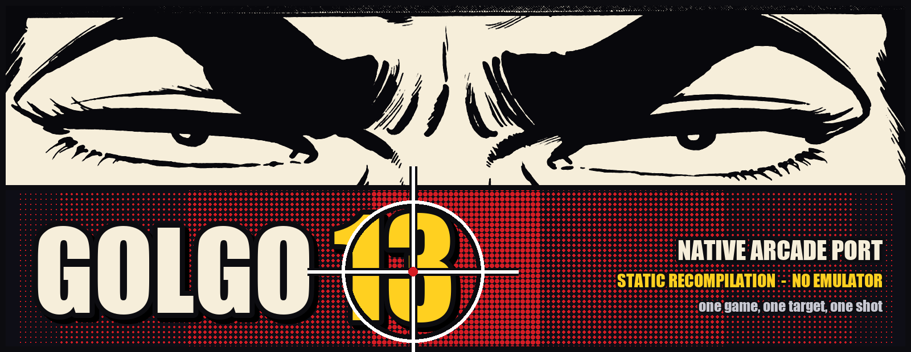
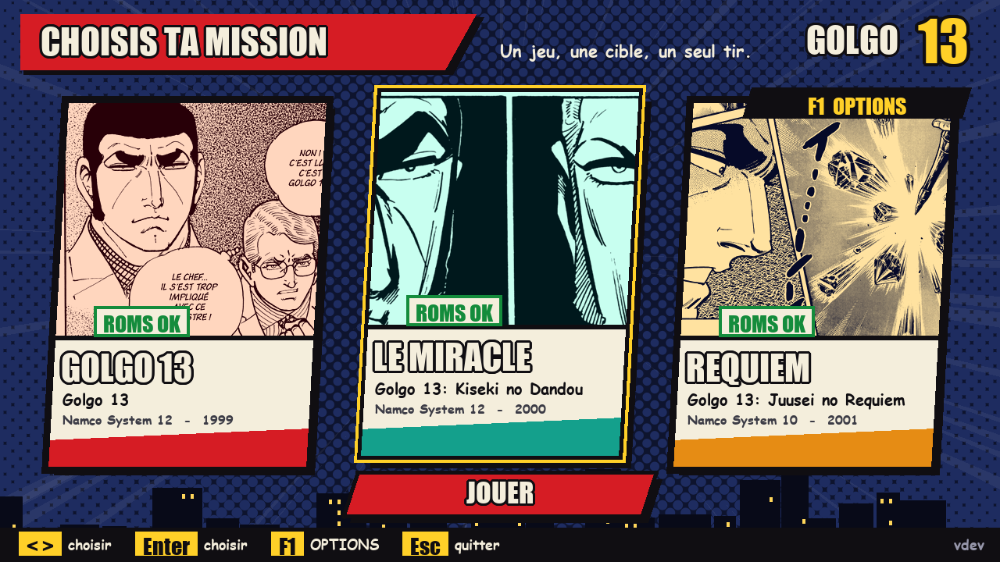
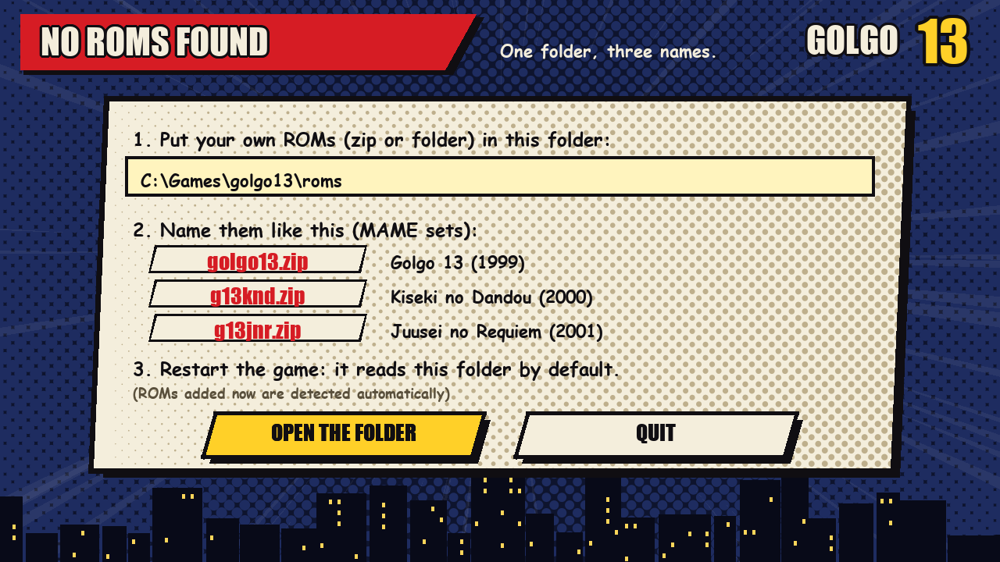
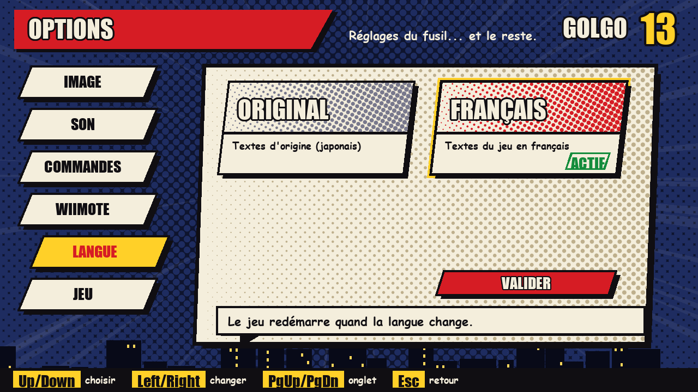

<p align="center"></p>

# Golgo 13 — native port of the Namco arcade games

[](https://github.com/naparuba-retro/golgo13/actions/workflows/ci.yml)
[](https://github.com/naparuba-retro/golgo13/releases)
[](LICENSE)


-success)


A **native** port (C11 + SDL3) of three *Golgo 13* arcade light-gun games. The game code is **statically recompiled** (MIPS → C): there is no CPU interpreter, the games run as plain compiled code.
**No ROM, no game code and no game image is included** — you bring your own ROMs, the port builds everything else on your machine.



| Game | Board | Status |
|---|---|---|
| **Golgo 13** (1999) | Namco System 12 | playable, French translation |
| **Golgo 13: Kiseki no Dandou** (2000) | Namco System 12 | playable, French translation (advanced) |
| **Golgo 13: Juusei no Requiem** (2001) | Namco System 10 + MP3 board | playable with sound and music, French translation in progress |

## Quick start (3 steps)

**1. Put your ROMs in the `roms/` folder** (next to this README). MAME sets, zip files or folders:

```
roms/
  golgo13.zip     Golgo 13
  g13knd.zip      Golgo 13: Kiseki no Dandou
  g13jnr.zip      Golgo 13: Juusei no Requiem
```

You only need the games you want to play. Launching the game with no ROM shows a screen that tells you exactly where to put them (and it notices them as soon as you drop them in):



**2. Build everything with one command** (Python 3.10+, and a C compiler: Visual Studio / Build Tools on Windows, CMake + gcc on Linux):

```
python tools/setup.py
```

Everything runs inside a project-local virtual environment (`.venv`, created automatically): **nothing is ever installed in your global Python**. It downloads the small third-party files (SDL3, minimp3), reads your ROMs, generates the game code **on your machine**, compiles the program and builds the French translation. Run it again whenever you add a ROM; finished steps are skipped (`--no-translations` to skip the slow translation step).

> **Prefer not to clone?** Download the latest bundle from the [Releases](https://github.com/naparuba-retro/golgo13/releases) page (Windows zip / Linux tar.gz), extract it, put your ROMs in `roms/`, run the program, pick a game: the in-app build screen does step 2 for you (it needs Python 3.10+ and a C compiler).

**3. Play**: run `build\golgo13.exe` (Windows) or `build-linux/golgo13` (Linux). By default the game looks for your ROMs in `roms/`.

> Why a build step? The recompiled game code is derived from the ROMs, so it can neither be shipped nor redistributed. The GitHub CI therefore builds the program *without* game code (menu only); `tools/setup.py` does the rest locally.

## The menu

On start you get a comic-book launcher: pick a card (arrows, mouse, gamepad, or Wiimote pointer), then **PLAY**. **F1** opens the options, **Esc** pauses a running game (resume, options, change game, restart, quit).

| Options | Language |
|---|---|
|  |  |

- **Video**: fullscreen (F11), integer scaling, 4:3 or fill window, sharp/smooth filter, CRT scanlines, FPS counter, vsync.
- **Sound**: volume, mute. **Controls**: two keys per action (press-a-key capture), reset. **Wiimote**: enable, smoothing, dead zone, pair, calibrate.
- **Language**: Original, or any translation found in `translations/` (French included).
- **Game**: credits always at maximum, trigger/scope doubling as Start (play with the mouse only: fire + scope), session recording, crosshair.
- Settings are saved in `settings.ini` (data folder); only changed values are written.
- The long *NOTICE* screen at start is shortened: Golgo walks in, aims at the countdown and shoots (right click skips).

> The manga panels shown are from *Golgo 13* by Takao Saito (Saito Production / Shogakukan), reproduced small to illustrate the menu. In the program, card pictures are cut **on your machine** from your own scans (`tools/ui/make_art.py`) and are not distributed; without them the cards are drawn with a halftone pattern.

## Controls

| Action | Keyboard / mouse | Gamepad | Wiimote |
|---|---|---|---|
| Aim | mouse | right stick | IR pointer |
| Fire | left click, Ctrl, Space | RT / A | B |
| Scope (zoom) | right click, Shift | LT / B | A |
| Start | 1 | Start | + |
| Coin | 5 | Back | − |
| Enter / Up / Down | Enter, ↑, ↓ | X, d-pad | 1, d-pad |
| Test / Service | F1 / F2 | | 2 |
| Pause menu | Esc | L1 + R1 (options) | Home |
| Crosshair, fullscreen | F3, F11 | | |

Modern light guns (Sinden, Aimtrak, Gun4IR…) show up as an absolute mouse and work as is.

## Playing with a Wiimote (Windows)

You need a Wiimote, a Bluetooth adapter and the **infrared sensor bar** (powered by 5 V USB, or two candles — without it the remote sees nothing).

1. **Pair** (once). Windows 11 cannot supply the Wiimote's binary PIN, so the game does it itself.
   - Remove any existing “Nintendo RVL-CNT-01” in the Windows Bluetooth settings first.
   - Run `golgo13.exe --wiimote-pair`, then **hold the red SYNC button** (under the battery cover) or 1+2 until it prints “Paired”.
   - You may have to retry: the program alternates between two PIN methods. Pairing with the PC replaces the Wii pairing (press SYNC on the console to use it there again).
2. **Place the bar** centred above or below the screen.
3. **Run** `golgo13.exe --wiimote` (or enable it in Options > Wiimote). Press a button on the remote to wake it; LED 1 lights up.
4. **Calibrate**: a full-screen assistant appears on first use. Aim at the green cross (top-left), press **A**; then bottom-right, **A**; then check the red cross follows you, **A**. Saved in `wiimote.cal`. Redo it any time from Options > Wiimote > Calibrate.

The mouse still works; the Wiimote takes over while the bar is in view. If pairing fails, try another Bluetooth adapter, or a Dolphin Bar (the remote then behaves like a mouse, nothing to change here). Details: `docs_wiimote.md`.

## Translation

Modular system (Original / `fr`): Japanese texts are translated, English texts are left as they are. The texts (`strings*.json`) are versioned; the translated pictures (`overlay.g13o`, `patch.g13t`) are built from your ROMs (they embed game pixels, so they are not published). See `translations/README.md` and `translations/TODO.md`.

**You do not have to build them by hand**: `python tools/setup.py` records the scenes and builds the translated pictures for every game you have (the first run is the slowest step, about as long as the game code; `--no-translations` skips it). Then pick *Français* in Options > Language. By hand: `python tools/translation/build.py --lang fr` (game 1), or `--translations translations/g13knd --rom <ROM folder>` / `translations/g13jnr` (game 3: `python tools/jnr/packs.py` first).

## Manual build (what `tools/setup.py` does)

- **Windows (MSVC)**: `python tools/setup_sdl3.py`, `python tools/setup_deps.py`, then `python tools/build/build.py` → `build/golgo13.exe`.
- **Linux / Steam Deck**: `cmake -S . -B build && cmake --build build` (add `-DGOLGO_FETCH_SDL3=ON` if SDL3 is not installed).
- **Game code**: `golgo13 --game <id> --dump-regions <dir>` writes the ROM regions; then `python tools/recomp_mips/analyze.py` and `gen_all.py`, and for System 12 games `tools/recomp_h8/flow.py` then `gen.py` (folders `generated*/`, git-ignored). Other games: `GOLGO_GAME=g13knd` (regions in `work/g13knd/`, output in `generated_g13knd/`, prefixed symbols); the System 10 game uses `tools/jnr/prepare.py` (NAND). One executable holds every generated game; the selector picks which one runs. Python is only used by the tools.
- **Menu pictures** (optional): `python tools/ui/bake_font.py`, then `python tools/ui/make_art.py <your scans>`.

## Where things are looked for

ROMs: `./roms`, then `roms/` next to the program, then your user data folder (`roms/<id>/` or `roms/<id>.zip`). Settings, calibration, recorded sessions and imported ROMs live in the per-user data folder (`GOLGO13_DATA` overrides it).

## Notes

- `PLAN.md`: architecture and constraints. `docs_aim.md`: aim calibration. `docs_wiimote.md`: Wiimote.

## Command line (debug / tooling)

None of this is needed to play.

| Option | Effect |
|---|---|
| `--game <id>` | skip the selector (`golgo13`, `g13knd`, `g13jnr`) |
| `--lang <code>` | force a language for this run (`original`, `fr`) |
| `--roms DIR` / `--import ZIP\|DIR` | use ROMs from a folder / copy a ROM set into the data folder |
| `--wiimote` / `--wiimote-pair` | enable the Wiimote / pair it |
| `--headless --frames N [--noaudio]` | run without a window for N frames |
| `--press frame:duration:button` | scripted input (coin, start, trigger, sensor, enter, up, down, test, pause…) |
| `--replay file.g13r` | replay a recorded session (sessions are recorded in the data folder) |
| `--shot FRAME FILE`, `--shotat f1,f2:prefix`, `--shotseq start:step:count:prefix` | screenshots at given frames |
| `--ramat f1,f2:prefix`, `--dump-ram FILE` | RAM dumps |
| `--menu-shots DIR` | render every menu page to PPM files (no window) |
| `--dump-regions DIR` | write the ROM regions read by the recompiler (used by `tools/setup.py`) |
| `--bot FILE` | test bot that plays from the display (tooling) |
| env `GOLGO13_NOGAG=1` | disable the NOTICE gag; `GOLGO13_DATA=dir` changes the data folder |

## License and credits

Code under the MIT license (`LICENSE`). Credits and trademarks: `NOTICE.md`. This project is not affiliated with Namco / Bandai Namco, Shogakukan or Saito Production; the ROMs and the works remain their property.
